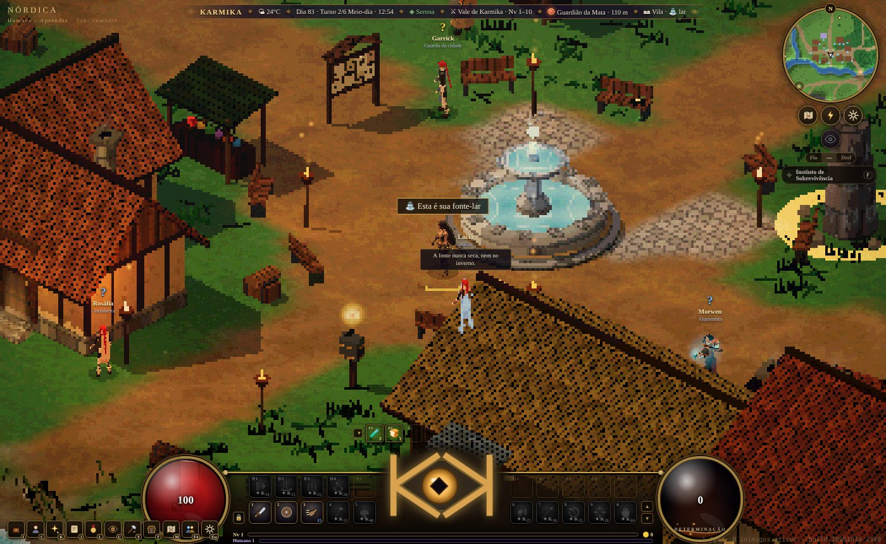
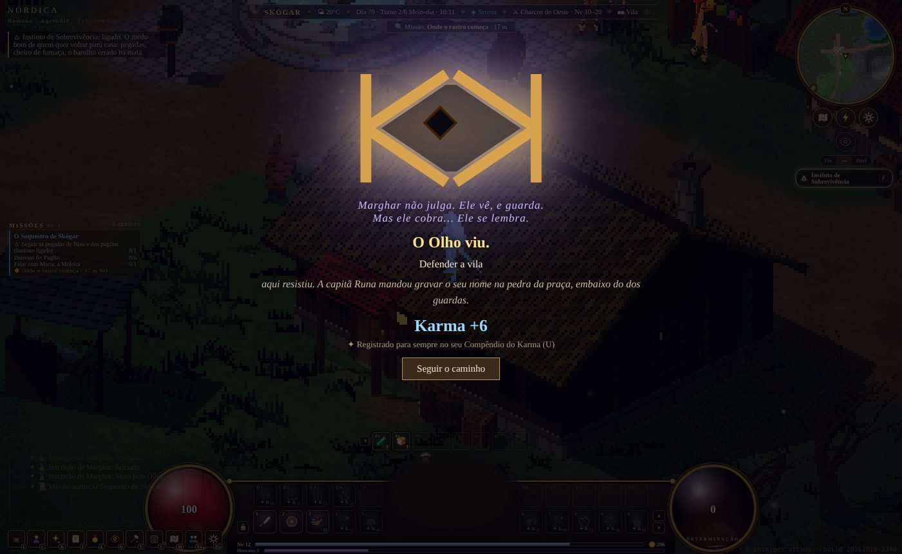
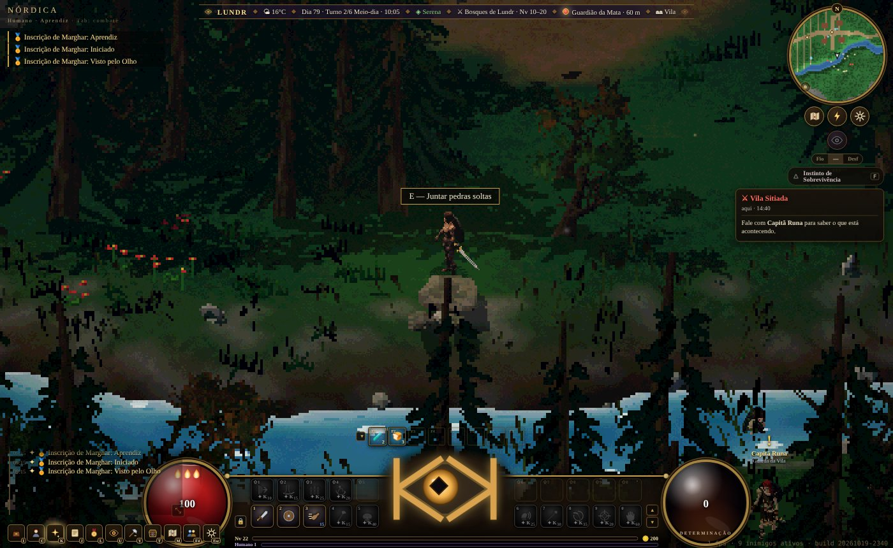
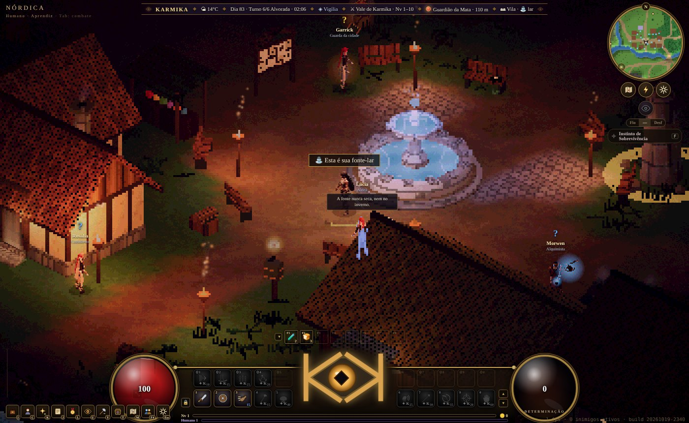
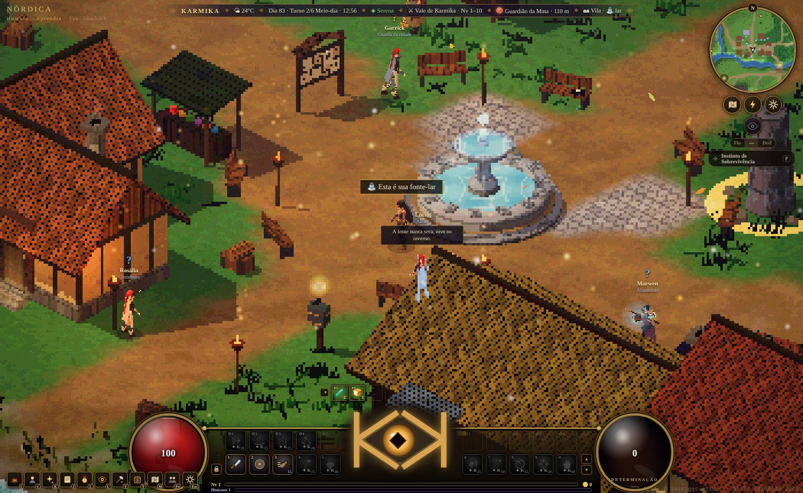
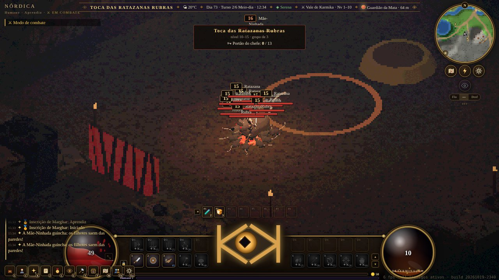
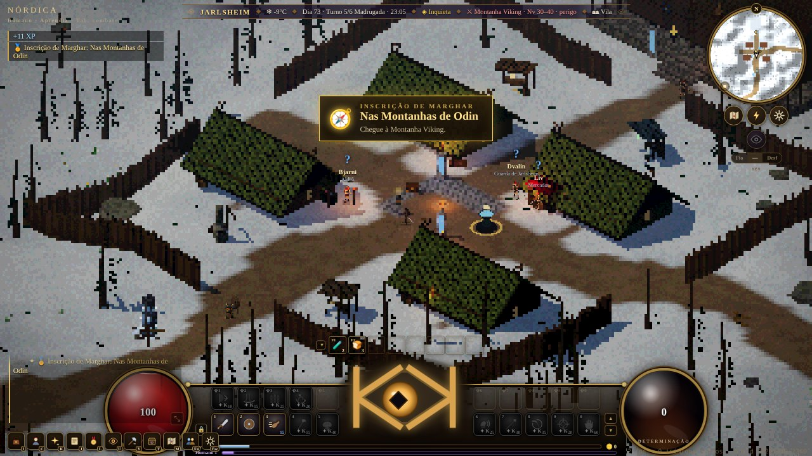
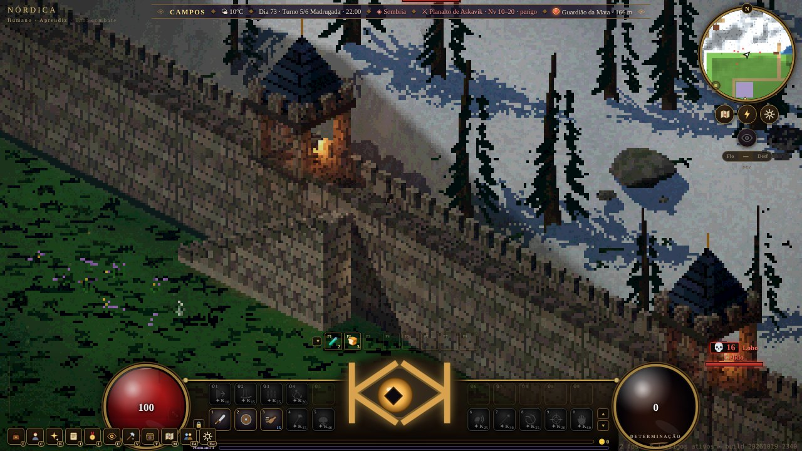
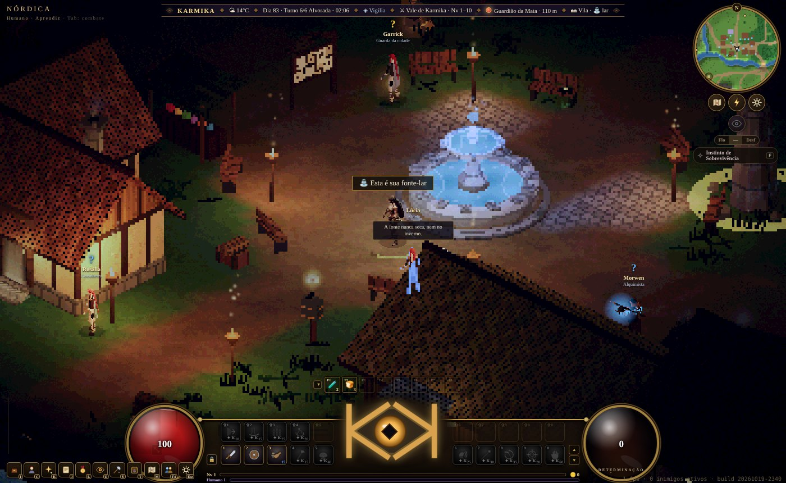

<div align="center">

# ✦ K A R M I K A ✦

### *Toda escolha importa. Você já fez a sua.*

**Um MMORPG isométrico em pixel art onde a morte não é o fim, as escolhas viram karma e o karma volta para cobrar.**



</div>

---

## Você não escolhe uma classe. Você se torna uma.

Em KARMIKA todo mundo nasce simples: **humano, anão ou elfo**. Ninguém escolhe "mago" numa tela de criação. O que você vira depende do que você **faz** no mundo:

- 🗡️ **Guerreiro Nórdico**: dedica a vida a Odin nas Montanhas Viking e luta sob a Lei do Aço.
- ✝️ **Paladino**: jura diante da Igreja de Karmika e carrega a luz até onde ela não chega.
- 🩸 **Vampiro**: foi mordido numa noite errada e agora a sede de sangue fala mais alto.
- 🐺 **Lobisomem**: entrou para uma guilda licantropa e a lua cheia nunca mais foi só uma lua.
- ⚙️ **Tecnocrata**: estudou na Academia Tecnológica e luta com engrenagens, vapor e lógica.
- 🔮 **Mago** e **Bruxo**: anos de estudo ou um pacto, a luz do Pináculo ou o sussurro das trevas.
- 🏹 **Caçador de Demônios**: formado na escola que caça o que os outros têm medo de nomear.

Cada caminho tem a sua saga do nível 30 ao 40, com mestre, prova, juramento e um ponto sem volta.

## A morte não é o fim. É o começo da próxima vida.

Quando o Fio da Vida se rompe, você **desencarna**. A alma sobe ao Limiar, encara o que fez e **renasce humana**, trazendo ecos da vida anterior:

> Fui um vampiro morto por um caçador. Na nova vida ainda sinto sede de sangue, não suporto alho, e os profetas das guildas sabem que a minha alma voltou. Eles vêm atrás de mim.

Marcas da alma, votos quebrados, inimigos que lembram de você: o passado pesa nas decisões e nos acontecimentos da vida nova.



## O Olho de Marghar vê tudo

O símbolo de KARMIKA, o Olho, não julga. Ele vê, guarda e cobra.

- **Poupar ou matar** um elite derrotado.
- **Ajudar** a caravana atacada ou **saquear** os destroços.
- **Defender** a vila sitiada ou **roubar** as casas na confusão.
- **Casar** os noivos quando o padre sumiu ou **roubar** a mesa de presentes.

Tudo entra na barra de Karma, no Compêndio da sua alma e na forma como o mundo te trata. Dá para ser bom. Dá para ser mau. Só não dá para fingir que não escolheu.

## Um mundo vivo, que acontece com ou sem você



- **Eventos regionais de 15 minutos** nascem pelo mapa e rodam entre as vilas:
  - patrulhas atacadas por lobisomens sob a lua cheia;
  - bruxos invocando nas vilas;
  - romarias da Aurora;
  - caçadores malditos nas matas;
  - festas, casamentos e cercos.
- Chegue perto, ouça o arauto e escolha um lado. No fim vem a **Resposta Kármica**.
- **Caravanas a vapor** da Companhia de Latão cruzam as estradas. Escolte, resgate ou assalte.
- **Ciclo de dia e noite** de verdade: o dia é dourado e quente, a noite é azul e fria. Há NPCs que só aparecem depois que o sol se põe.

### 🌑 Lua de Sangue

<div align="center">



</div>

Num dia diferente a cada vez, para quem tem horário apertado não perder sempre:
- o mundo inteiro se tinge de vermelho;
- cinzas sobem da terra e um pulso grave bate como um coração;
- vampiros, lobisomens, bruxos e toda alma de karma baixo **ficam mais fortes**.

### ☀️ Dia da Aurora

<div align="center">



</div>

- Brisa morna, folhas voando e brilhos caindo do céu.
- Um coral de anjos ao longe.
- Paladinos, magos e toda alma de karma alto **ficam mais fortes**.

## O Instinto: o que só você vê

Aperte **F** e o seu Instinto de classe acorda: a Sede de Sangue do vampiro, o Faro da Lua do lobisomem, a Vigília da Fé do paladino, a Lógica do Mundo do tecnocrata.

Com ele ligado aparecem:
- pegadas na neve e gotas de sangue no caminho;
- espíritos da floresta e dispositivos perdidos;
- **36 esconderijos** espalhados pelo mundo, cada um com a sua história.

Há missões que **só podem ser feitas** com o Instinto ligado.

## Masmorras, cidades e um mapa enorme



- **Dezenas de vilas e cidades**: a Vila de Karmika, Jarlsheim na neve, a cidade-fortaleza de Askavik, Brasaforja dos anões, Lithendel dos elfos, o Castelo da Colina Vampírica, o Pináculo de Marfim e muitas outras.
- **Masmorras e cavernas** com chefes, elites que se rendem e escolhas no fim.
- **Profissões**: forja, carpintaria, alquimia, culinária, pesca, mineração, herbalismo, couro.
- **Construção**, leilão, mercado, correio, conquistas (Inscrições de Marghar) e títulos.

<div align="center">





</div>

## PVE forte, PVP liberado e o peso de cada abate

Matar outro jogador também é uma escolha, e também vira karma. Jogue junto em salas de até 12 pessoas e grupos de até 6: o próprio jogo abre o servidor e encontra as salas da sua rede.

## Arte

**Pixel art** de valor, sem granulação exagerada. Explosões, brilhos e auras bem feitos, sobre um mundo 3D desenhado como pixel art. Feito para rodar em muitos PCs.

<div align="center">



</div>

---

## 🛠️ Para quem vai rodar

**Requisitos:** Node.js 20 ou mais novo, e pnpm (`npm i -g pnpm`).

```bash
git clone https://github.com/Erlingsjunior/karmika.git
cd karmika
pnpm install
pnpm dev            # o jogo em http://localhost:5173
```

### Montar um servidor

```bash
pnpm install
pnpm build          # gera client/dist
pnpm sala           # sala multijogador na porta 7777 (WebSocket + entrega o jogo)
```

- Outra porta: `node desktop/src/server.cjs 8080`. Com senha: `--senha segredo`.
- Os jogadores entram por `http://IP-DA-MAQUINA:7777` ou pelo botão **Jogar junto (F4)**, com o convite que aparece no terminal.
- Na rede local as salas se anunciam sozinhas (UDP 7778).
- Pela internet, libere a porta **7777/TCP** no roteador e no firewall.
- Quem entrar com uma versão velha baixa só o que mudou.

### App de desktop (Electron)

```bash
pnpm desktop:dev    # abre como aplicativo
pnpm desktop:dist   # instalador do Windows em desktop/release
```

### Estrutura

| Pasta | O que tem |
|---|---|
| `client/` | o jogo (Vite + Three.js + TypeScript); entrada em `client/src/main.ts` |
| `shared/` | código comum (matemática isométrica, raças, A*) |
| `desktop/` | app Electron e servidor de sala (`desktop/src/server.cjs`) |
| `docs/` | bíblia do mundo, sagas, eventos, regras de design |

<div align="center">

---

*Marghar não julga. Ele vê, e guarda. Mas ele cobra… Ele se lembra.*

</div>
